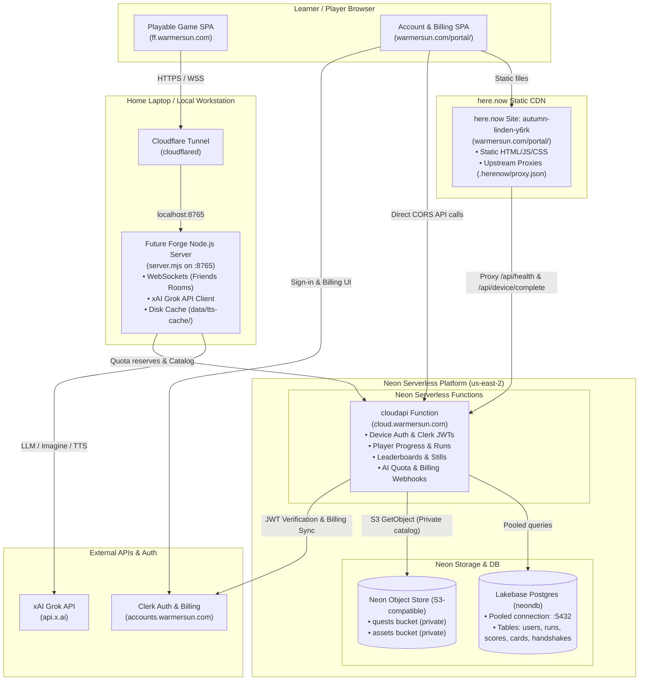

# System Topology, Deployments, and Environment Configuration

This document provides an authoritative overview of Future Forge's operational topology: what services run where, how they communicate, and how each component is configured with environment variables.

---

## 1. System Topology Overview

---

## 2. What Is Running Where

### 2.1. Portal SPA on here.now

| Property | Detail |
| --- | --- |
| **Platform** | **here.now** (Static site hosting / CDN) |
| **Site Identifier** | `autumn-linden-y6rk` (`https://autumn-linden-y6rk.here.now/`) |
| **Mounted Custom Domain** | `https://warmersun.com/portal/` |
| **Source Directory** | `portal/` |
| **Published Bundle** | `portal/index.html`, `portal/app.js`, `portal/app.css`, HTML route shells (`signin`, `subscribe`), and `.herenow/proxy.json` |

#### Key Responsibilities
- **Account Dashboard (`/portal/`)**: Displays player identity, cloud progress, unlocked achievements, and claimed collector cards.
- **Learner Sign-In (`/portal/signin`)**: Mounts Clerk's sign-in components and handles the device-code login flow initiated by the game client.
- **Subscription & Pricing (`/portal/subscribe`)**: Renders Clerk's Pricing Table and subscription checkout drawer for Warmer Sun Cloud memberships.

#### Runtime Discovery & Upstream Proxies
The SPA contains **no build-time secrets or static environment variables**. Instead, it dynamically discovers its configuration at runtime:
1. When loaded, `portal/app.js` fetches `/api/health` relative to itself.
2. The file `.herenow/proxy.json` (deployed from `portal/here-now/proxy.json`) routes specific endpoints directly to the backend:
   - `GET /api/health` &rarr; `https://cloud.warmersun.com/api/health`
   - `POST /api/device/complete` &rarr; `https://cloud.warmersun.com/api/device/complete`
3. `/api/health` responds with the active Clerk Publishable Key (`clerk.publishableKey`), backend API origin (`apiOrigin`), and allowed device origins.
4. Subsequent authenticated calls from the SPA send the user's Clerk JWT directly to `https://cloud.warmersun.com` using origin-bound CORS.

---

### 2.2. Portal Backend APIs on Neon Functions

| Property | Detail |
| --- | --- |
| **Platform** | **Neon Compute Functions** (`@neon/functions` serverless runtime) |
| **Project & Branch** | Project `proud-hill-53375382`, branch `main` (AWS `us-east-2`) |
| **Production Domain** | `https://cloud.warmersun.com` (Neon custom domain CNAME) |
| **Deployment Config** | `neon.portal.ts` (`neon deploy --config neon.portal.ts`) |
| **Primary Function** | `cloudapi` (source: `portal/functions/cloud-api-entry.mjs` &rarr; `portal/functions/cloud-api.mjs`) |
| **Diagnostic Function** | `portalgate` (API key smoke test, source: `portal/functions/api-key-check.ts` in dev/staging `neon.ts`) |

#### Serverless Function Architecture
The `cloudapi` function acts as the unified API gateway for Warmer Sun Cloud. It is stateless, automatically scales to zero when idle, connects to Neon PostgreSQL through an attached connection pooler, and holds private bucket credentials for reading official quest packages.

#### Complete Catalog of Backend APIs

##### 1. Health & Device Handshake (`portal/functions/cloud-api.mjs`)
- `GET /api/health`  
  Public health check. Returns service status, database connectivity, allowed CORS origins, and dynamic Clerk frontend configuration (`clerk.publishableKey`, `apiOrigin`).
- `POST /api/device/start`  
  Initiates the loopback/game sign-in handshake. Stores a 5-minute hashed one-time code in `device_handshakes` and returns the user sign-in URL (`https://warmersun.com/portal/signin?device=<code>`).
- `POST /api/device/complete`  
  Called by the portal SPA once the user authenticates with Clerk. Validates the bearer Clerk session token and binds a newly minted game session JWT to the device code.
- `GET /api/device/status?code=<code>`  
  Polled by the game client. Atomically consumes the completed handshake, removes the code, and delivers the minted game session JWT to the game.

##### 2. Account & Collector Cards (`portal/functions/account-routes.mjs`)
- `GET /api/me`  
  Returns learner identity, account standing, active subscription status, and remaining cloud AI quota points.
- `GET /api/me/cards`  
  Returns the list of collector cards unlocked and claimed by the learner.
- `POST /api/me/cards/:id/collect`  
  Claims an unlocked collector card to the learner's cloud inventory.

##### 3. Player Progress & Runs (`portal/functions/player-routes.mjs`)
- `GET /api/me/runs`  
  Retrieves historical quest runs for the signed-in player.
- `POST /api/me/runs/start`  
  Records the start of a new quest run session.
- `POST /api/me/runs`  
  Records completed run outcomes, evaluation scores, star ratings, and pathway metrics.
- `POST /api/me/runs/share`  
  Creates a shareable summary and payload for a completed run.
- `POST /api/me/import`  
  Imports anonymous local runs (from browser `localStorage`) into the user's permanent Neon profile upon first sign-in.
- `GET /api/me/pins` / `PUT /api/me/pins`  
  Reads and updates the player's pinned quest list.
- `GET /api/me/run-state` / `PUT /api/me/run-state`  
  Reads and saves in-flight quest execution state (powers the title-screen **Continue** button across devices).
- `GET /api/me/profile` / `PUT /api/me/profile`  
  Reads and updates the player's public profile (display handle, avatar).
- `GET /api/me/achievements`  
  Lists all unlocked milestones, badges, and achievements.

##### 4. Quests & Leaderboard Writes (`portal/functions/quest-write-routes.mjs`)
- `POST /api/report`  
  Accepts user feedback or content moderation reports.
- `POST /api/me/quests/:id/score`  
  Submits a verified quest score to the global leaderboard. Enforces run ownership and atomically updates leaderboard rankings.
- `PUT /api/me/quests/:id/still`  
  Submits a screenshot/still image for top leaderboard slots with automatic eviction of displaced ranks.

##### 5. Public Catalog, Profiles & Leaderboards (`portal/functions/public-routes.mjs`)
- `GET /api/quests`  
  Returns the public catalog of available quests (cached).
- `GET /api/quests/:id`  
  Retrieves a specific quest package manifest or metadata.
- `POST /api/quests/resolve-context`  
  Resolves quest world context and simulation parameters.
- `GET /api/u/:username`  
  Fetches public player profile, achievements, and showcase cards.
- `GET /api/board` / `GET /api/board/:questId`  
  Retrieves global quest leaderboards.
- `GET /api/board/:questId/still/:userId`  
  Fetches a player's submitted leaderboard still image.
- `GET /card/:id`  
  Renders the public collector card HTML and serves the OpenGraph preview image.

##### 6. Billing, Quota & Webhooks (`portal/functions/billing-routes.mjs`)
- `POST /api/me/ai/reserve`  
  Browser-initiated quota reserve hold prior to running AI operations.
- `POST /api/internal/ai/reserve`  
  Server-to-server quota reservation called by the hosted game server; authenticated via the shared secret `X-FF-Secret`.
- `POST /api/me/ai/settle`  
  Finalizes and settles actual AI compute points spent against a prior reservation.
- `POST /api/webhooks/clerk`  
  Svix-verified webhook endpoint listening for Clerk user and billing events (`subscription.created`, `subscription.updated`, `subscription.deleted`, `user.deleted`).

---

### 2.3. Hosted App at `ff.warmersun.com` (Home Laptop via Cloudflare Tunnel)

| Property | Detail |
| --- | --- |
| **Platform** | Local home laptop / workstation running Node.js (`node server.mjs` / `npm start`) |
| **Local Port** | Port `8765` bound to `0.0.0.0` or `127.0.0.1` |
| **Public URL** | `https://ff.warmersun.com` |
| **Ingress Proxy** | **Cloudflare Tunnel** (`cloudflared`) routing `https://ff.warmersun.com` &rarr; `http://localhost:8765` |
| **Core Components** | Playable Game SPA, WebSockets engine, xAI Grok client, local disk cache |

#### Why the Game App Runs as a Long-Running Process (Not Serverless)
1. **Real-time WebSockets**: Future Forge includes cooperative multiplayer "Friends" rooms (`/ws`). Persistent WebSockets require a stateful process to hold room state, peer lists, and low-latency broadcast channels.
2. **Disk Caching**: Synthesized speech audio is cached on disk under `data/tts-cache/` to eliminate duplicate xAI TTS costs across repeated quest play.
3. **xAI API Execution & Live AI Search**: The game server directly handles prompt assembly, vision inspection, live LLM streaming, and real-time web & X search (`FF_AI_SEARCH=1` or `--ai-search`) using xAI Grok (`FF_XAI_API_KEY`).
4. **Cloudflare Tunnel Simplicity**: Running on the home laptop behind Cloudflare Tunnel provides stable public HTTPS and WSS endpoints without requiring open inbound router ports, static home IPs, or costly cloud server hosting.

---

### 2.4. Neon Platform Services: RDBMS and Object Store

Neon provides the managed serverless infrastructure underpinning Warmer Sun Cloud:

| Neon Service | Configuration & Usage |
| --- | --- |
| **Lakebase Postgres (RDBMS)** | **Database:** `neondb` on project `proud-hill-53375382`, branch `main` (AWS `us-east-2`). **Connection Pooling:** Serverless functions connect via Neon's connection pooler (`ep-...-pooler...` on port 5432) to prevent connection spikes under concurrent traffic. **Direct Endpoint:** Dedicated unpooled host (`ep-...`) used for schema migrations and DDL operations. **Key Tables:** `users`, `runs`, `quest_scores`, `user_collector_cards`, `collector_cards`, `device_handshakes`, `clerk_webhook_events`. |
| **Neon Object Store (S3-Compatible)** | **Private Buckets:** • `quests`: Stores official quest packages, lesson manifests, scenario packs, assets, and AI tutor context. Gated behind authentication; read only by `cloudapi` and never exposed directly to browser inspection. • `assets`: Stores brand marks, illustrations, and static badges. **API Compatibility:** S3 API standard, queried via `@aws-sdk/client-s3` using storage credentials (`AWS_ACCESS_KEY_ID`, `AWS_SECRET_ACCESS_KEY`, `AWS_ENDPOINT_URL_S3`). |

---

## 3. Environment Variable Configuration Guide

This section details all environment variables required for each running application, what each variable does, and exactly where to locate or generate its value.

### 3.1. Hosted Game App (`server.mjs` on Home Laptop)

**Config Location:** `.env` (gitignored, copied from `.env.example`) or `.env.local`.

| Variable | Required? | Default / Example | Purpose | Where to Find the Value |
| --- | --- | --- | --- | --- |
| `FF_PORT` | Optional | `8765` | Local TCP port for the game server to listen on. | Set manually in `.env`. Default is `8765`. |
| `FF_HOST` | Optional | `0.0.0.0` | Network interface to bind (`0.0.0.0` for all interfaces, `127.0.0.1` for loopback). | Set manually in `.env`. |
| `FF_PORTAL_URL` | **Required** for Cloud | `https://cloud.warmersun.com` | Base origin of the portal backend API (Neon Function). Used for device sign-in, cloud saves, and quota checks. | Constant: `https://cloud.warmersun.com` (custom domain of the Neon `cloudapi` Function). |
| `FF_PORTAL_UI_URL` | **Required** for Cloud | `https://warmersun.com/portal/` | Public URL of the portal SPA. Used for generating sign-in links and upgrade prompts. | Constant: `https://warmersun.com/portal/`. |
| `FF_PORTAL_QUESTS` | Optional | `1` | Set to `1` to fetch quests from the hosted Neon portal catalog instead of relying solely on local disk. | Operator preference. Set to `1` on hosted deployment. |
| `FF_CLOUD_AI` | Optional | `1` | Set to `1` to enforce cloud AI subscription quota verification via portal before calling xAI. | Operator preference. Set to `1` on the production hosted service. |
| `FF_API_SECRET` | **Required** if `FF_CLOUD_AI=1` | `(random 64-char secret)` | Shared secret between game server and portal Function. Sent as header `X-FF-Secret` for internal quota reserve calls (`/api/internal/ai/reserve`). | Generate with `openssl rand -hex 32` (note the `-hex` flag to produce a readable hex string, or use `node -e "console.log(crypto.randomBytes(32).toString('hex'))"`). Must match `FF_API_SECRET` configured on the Neon `cloudapi` Function. |
| `FF_XAI_API_KEY` | **Required** for AI | `xai-...` | API key used by the game server to invoke xAI Grok for co-inventing, text, images, and voice. | **xAI Console** ([console.x.ai](https://console.x.ai/)) &rarr; **API Keys** &rarr; **Create Key**. |
| `FF_XAI_MODEL` | Optional | `grok-4.7` | xAI Grok model used for reasoning and conversational co-invention. | Set in `.env`. Options include `grok-4.7` or newer Grok versions. |
| `FF_XAI_IMAGE_MODEL` | Optional | `grok-imagine-image` | xAI model used for generating scenario and card images. | Set in `.env`. Default is `grok-imagine-image`. |
| `FF_AI_SEARCH` | Optional | `1` | Enables live web and X (Twitter) search via Grok for timing/feasibility checks and "Ask for ideas" sparks. Off by default (can also be passed as CLI flag `--ai-search`). | Set to `1` in `.env` (or pass `--ai-search` to `server.mjs`). Force off with `--no-ai-search`. |
| `FF_DEVELOPER` | Optional | `1` | Enables developer mode UI (quest inspection, trend inspection, and debug panels). Off by default. | Set to `1` in `.env` (or pass `--developer` to `server.mjs`). |
| `FF_TTS_VOICE` | Optional | `eve` | Default voice persona for text-to-speech audio synthesis. | Set in `.env`. Supported voices include `eve`, `ara`, etc. |
| `FF_TTS_CACHE_DIR` | Optional | `./data/tts-cache` | Directory path on local disk to store cached TTS audio files. | Local filesystem directory path. Default is `./data/tts-cache`. |
| `FF_GROK_HOME` | Optional | `~/.grok` | Path to Grok CLI credentials directory. Set to `/dev/null` to force exclusive use of `FF_XAI_API_KEY`. | Local filesystem path. Default is `~/.grok`. |
| `FF_TRUST_PROXY` | Optional | `1` | Uses `X-Forwarded-For` for rate-limiting keys instead of the raw socket IP (`127.0.0.1`). Recommended when hosting publicly so rate limits apply per visitor IP rather than sharing one bucket for all players. Off by default. | Set to `1` if you want per-visitor rate limiting behind Cloudflare Tunnel. Leave unset otherwise. |
| `FF_JOIN_ORIGIN` | Optional | `https://ff.warmersun.com` | Public base URL included in multiplayer Friends room share invitations. | Constant: `https://ff.warmersun.com` (or your active tunnel hostname). |
| `FF_MAX_ROOMS` | Optional | `10` | Maximum number of concurrent active multiplayer rooms to permit. | Operator limit. Default is `200` locally, or `10` for public server. |
| `FF_ENABLE_ROOMS` | Optional | `1` | Toggles the multiplayer Friends room system on (`1`) or off (`0`). | Set to `1` to enable multiplayer rooms. |
| `FF_WS_MAX_PAYLOAD` | Optional | `262144` | Maximum incoming WebSocket message payload in bytes (default 256 KB). | Set in `.env` if custom limits are needed. |
| `FF_USAGE_ENABLED` | Optional | `1` | Enables local tracking of token usage, images, and TTS operations for cost estimation. | Set to `1` to write metrics into `data/usage/`. |
| `FF_QUESTS_REMOTE_URL` | Optional | `https://warmersun.com/quests/catalog.json` | Fallback URL to load quest definitions if not using local catalog (`off` to disable). | Default: `https://warmersun.com/quests/catalog.json`. |
| `FF_TRENDS_REMOTE_URL` | Optional | `https://warmersun.com/trends/catalog.json` | URL to fetch macro trend cards and charts (`off` to disable). | Default: `https://warmersun.com/trends/catalog.json`. |
| `FF_PREDICTIONS_FILE` | Optional | `predictions/default.json` | Path to predictions dataset used for the year dialog and outcome simulation. | Local path: `predictions/default.json` or custom file in `predictions/`. |

---

### 3.2. Portal Backend APIs (Neon Functions: `cloudapi`)

**Config Location:** Configured via `neon.portal.ts` and deployed using `neon deploy --config neon.portal.ts --env <env-file> --project-id proud-hill-53375382 --branch main --no-env-pull` (or managed in the **Neon Console** under **Functions** &rarr; **Environment Variables**).

| Variable | Required? | Default / Example | Purpose | Where to Find the Value |
| --- | --- | --- | --- | --- |
| `CLERK_PUBLISHABLE_KEY` | **Required** | `pk_live_...` | Clerk Publishable Key delivered to clients in `/api/health` to initialize Clerk SDK. | **Clerk Dashboard** ([dashboard.clerk.com](https://dashboard.clerk.com/)) &rarr; **API Keys** &rarr; **Publishable Key**. |
| `CLERK_SECRET_KEY` | **Required** | `sk_live_...` | Clerk Secret Key used by backend to verify session JWTs and query Clerk User APIs. | **Clerk Dashboard** &rarr; **API Keys** &rarr; **Secret Key**. |
| `CLERK_WEBHOOK_SECRET` | **Required** | `whsec_...` | Svix signing secret for verifying inbound webhooks at `/api/webhooks/clerk`. | **Clerk Dashboard** &rarr; **Configure** &rarr; **Webhooks** &rarr; Select Endpoint (`https://cloud.warmersun.com/api/webhooks/clerk`) &rarr; **Signing Secret**. |
| `FF_PORTAL_SESSION_SECRET` | Optional | `(random 64-char hex)` | Secret used to sign game session JWTs minted during device code exchange. Falls back to `CLERK_SECRET_KEY` if omitted. | Generate with `openssl rand -hex 32` (requires `-hex` for readable output) or reuse Clerk secret. |
| `FF_API_SECRET` | **Required** | `(random 64-char secret)` | Shared secret used to authenticate internal server-to-server quota reserve requests (`/api/internal/ai/reserve`). | Must match `FF_API_SECRET` on the hosted game server. |
| `FF_PUBLIC_ORIGIN` | **Required** | `https://cloud.warmersun.com` | Canonical public origin of the Cloud API. Used for CORS allowlisting and device sign-in links. | Constant: `https://cloud.warmersun.com`. |
| `FF_PORTAL_UI_URL` | **Required** | `https://warmersun.com/portal/` | Public origin of the portal SPA. Returned by `/api/health` so clients link to the correct UI. | Constant: `https://warmersun.com/portal/`. |
| `FF_QUESTS_BUCKET` | **Required** | `quests` | Name of the private Neon Object Storage bucket holding official quest packages. | Neon bucket name (`quests`). Created via `neon.portal.ts` / Neon Console. |
| `FF_GAME_DEVICE_ORIGINS` | Optional | `https://ff.warmersun.com` | Comma-separated list of additional game origins allowed for device handshake CORS (loopbacks and LAN IPs are allowed automatically). | Add `https://ff.warmersun.com` and any custom Tailscale Funnel origins. |
| `FF_ALLOW_LAN_ORIGINS` | Optional | `1` | Controls whether private LAN origins (`192.168.x.x`, `10.x.x.x`, `172.16-31.x.x`) are allowed for device handshake CORS. Default `1` (allowed); set to `0` to forbid. | Operator preference. Default is `1`. |
| `FF_CLOUD_PLAN_SLUGS` | **Required** | `cloud` | Comma-separated list of Clerk subscription plan slugs eligible to spend Cloud AI quota. | Matches plan slug created in **Clerk Dashboard** &rarr; **Billing** &rarr; **Plans** (e.g. `cloud`). |
| `FF_CLOUD_AI_BUDGET` | **Required** | `5000` | Points allocated per billing cycle for active subscribers. | Defined by operator pricing model (e.g., `5000` points). |
| `FF_QUOTA_TEXT_IN_PER_KTOK` | **Required** | `2` | Quota points charged per 1,000 prompt input tokens. | Operator policy (see `.env.portal.example`). Default `2`. |
| `FF_QUOTA_TEXT_OUT_PER_KTOK` | **Required** | `6` | Quota points charged per 1,000 generated output tokens. | Operator policy (see `.env.portal.example`). Default `6`. |
| `FF_QUOTA_TEXT_HOLD` | **Required** | `20` | Headroom hold points temporarily reserved while awaiting text generation stream. | Operator policy. Default `20`. |
| `FF_QUOTA_TEXT_MAX_OUT` | **Required** | `8192` | Maximum output token ceiling allowed during single generation reservation. | Operator policy. Default `8192`. |
| `FF_QUOTA_IMAGE` | **Required** | `20` | Quota points charged per generated image. | Operator policy. Default `20`. |
| `FF_QUOTA_TTS_PER_KCHAR` | **Required** | `15` | Quota points charged per 1,000 characters of TTS audio. | Operator policy. Default `15`. |
| `FF_QUOTA_VOICE_PER_MIN` | **Required** | `160` | Quota points charged per minute of real-time voice session. | Operator policy. Default `160`. |
| `DATABASE_URL` | Automatic / Injected | `postgresql://...` | Connection-pooled PostgreSQL connection string (`ep-...-pooler.c-6.us-east-2.aws.neon.tech/neondb?sslmode=require`). | **Automatically injected by Neon** into the function environment on the target branch. Also available in **Neon Console** &rarr; **Dashboard** &rarr; **Connection Details** (select "Pooled"). |
| `AWS_ACCESS_KEY_ID` | Automatic / Optional | `nak_live_...` | S3 access key ID for accessing Neon private object buckets. | Generated in **Neon Console** &rarr; **Project Settings** &rarr; **Storage Keys** (injected automatically when using `@neon/functions`). |
| `AWS_SECRET_ACCESS_KEY` | Automatic / Optional | `nsk_live_...` | S3 secret access key for accessing Neon private object buckets. | Generated in **Neon Console** &rarr; **Project Settings** &rarr; **Storage Keys**. |
| `AWS_ENDPOINT_URL_S3` | Automatic / Optional | `https://br-....storage.c-6.us-east-2.aws.neon.tech` | S3 endpoint URL for Neon Object Store. | Displayed in **Neon Console** &rarr; **Object Storage** &rarr; **Bucket Details**. |
| `AWS_REGION` | Automatic / Optional | `us-east-2` | AWS region corresponding to the Neon project. | Region selected for the Neon project (e.g., `us-east-2`). |

---

### 3.3. Portal SPA on here.now (`warmersun.com/portal/`)

**Config Location:** Static deployment. Zero frontend environment variables required.

| Configuration Item | Detail | Purpose | Where to Find / Configure |
| --- | --- | --- | --- |
| **Upstream Proxies** (`.herenow/proxy.json`) | `/api/health` &rarr; `https://cloud.warmersun.com/api/health` `/api/device/complete` &rarr; `https://cloud.warmersun.com/api/device/complete` | Allows same-origin fetches from the static SPA to reach the backend without CORS complexity or exposing secrets. | File `portal/here-now/proxy.json`. Copied as `.herenow/proxy.json` during deployment. |
| **here.now Deploy Token** | `HERENOW_TOKEN` (CLI auth) | Authorizes publishing updated assets to here.now site `autumn-linden-y6rk`. | **here.now Dashboard** &rarr; Account Settings &rarr; Access Tokens (or via `herenow login`). |
| **Custom Domain Mount** | `https://warmersun.com/portal/` | Domain routing rule mapping `/portal/*` path on `warmersun.com` to here.now Site `autumn-linden-y6rk`. | Configured in **here.now Dashboard** &rarr; Custom Domains (attached to `warmersun.com`). |

---

### 3.4. Cloudflare Tunnel (`cloudflared` on Home Laptop)

**Config Location:** `~/.cloudflared/config.yml` or configured via **Cloudflare Zero Trust Dashboard**.

| Configuration Item | Detail | Purpose | Where to Find / Configure |
| --- | --- | --- | --- |
| **Tunnel Token / Credentials** | `TUNNEL_TOKEN` or `~/.cloudflared/<tunnel-id>.json` | Authenticates the local `cloudflared` daemon with Cloudflare Edge. | **Cloudflare Zero Trust** ([one.dash.cloudflare.com](https://one.dash.cloudflare.com/)) &rarr; **Networks** &rarr; **Tunnels** &rarr; Select Tunnel &rarr; **Install Connector Token**. |
| **Ingress Rule: Hostname** | `ff.warmersun.com` | Public hostname exposed to players. | **Cloudflare Zero Trust** &rarr; Tunnel Ingress Rules &rarr; Hostname: `ff.warmersun.com`. |
| **Ingress Rule: Service** | `http://localhost:8765` | Local destination service forwarding incoming HTTP and WebSocket traffic. | Set service URL to `http://localhost:8765` in tunnel ingress config. |
| **DNS Record** | CNAME `ff.warmersun.com` &rarr; `<tunnel-id>.cfargotunnel.com` | Directs public DNS queries to Cloudflare's tunnel edge. | Created automatically when adding public hostname in Cloudflare Zero Trust. |

---

### 3.5. Neon Database & Object Store (Platform Credentials)

**Config Location:** Managed in **Neon Console** ([console.neon.tech](https://console.neon.tech/)) for project `proud-hill-53375382`.

| Resource | Value / Format | Purpose | Where to Find the Value |
| --- | --- | --- | --- |
| **Project ID** | `proud-hill-53375382` | Identifies the project across Neon CLI and deploy commands. | **Neon Console** &rarr; Project Settings &rarr; General &rarr; **Project ID**. |
| **Active Branch** | `main` | Production branch holding schema and serverless functions. | **Neon Console** &rarr; **Branches** &rarr; `main`. |
| `DATABASE_URL` (Pooled) | `postgresql://neondb_owner:<pwd>@ep-...-pooler.c-6.us-east-2.aws.neon.tech/neondb?sslmode=require` | Pooled connection string used by serverless functions and high-concurrency runtime queries. | **Neon Console** &rarr; **Project Dashboard** &rarr; **Connection Details** &rarr; Enable **Pooled connection** checkbox &rarr; Copy string. |
| `DATABASE_URL_UNPOOLED` (Direct) | `postgresql://neondb_owner:<pwd>@ep-...c-6.us-east-2.aws.neon.tech/neondb?sslmode=require` | Direct database connection string used for schema migrations and DDL scripts. | **Neon Console** &rarr; **Project Dashboard** &rarr; **Connection Details** &rarr; Disable **Pooled connection** checkbox &rarr; Copy string. |
| `AWS_ENDPOINT_URL_S3` | `https://br-....storage.c-6.us-east-2.aws.neon.tech` | S3-compatible endpoint for Neon Object Storage buckets. | **Neon Console** &rarr; **Object Storage** &rarr; Bucket Details. |
| `AWS_ACCESS_KEY_ID` / `AWS_SECRET_ACCESS_KEY` | `nak_live_...` / `nsk_live_...` | API credentials for reading private bucket objects. | **Neon Console** &rarr; **Project Settings** &rarr; **Storage Keys** &rarr; **Generate Key**. |

---

## 4. Clerk Dashboard Configuration Checklist

To allow players to sign in, purchase subscriptions, and sync accounts across both the hosted app (`ff.warmersun.com`) and portal (`warmersun.com/portal/`), configure the following in the **[Clerk Dashboard](https://dashboard.clerk.com/)**:

### 4.1. Allowed Origins & Redirect URLs
- **Domains & Routing**: Ensure your Clerk production instance allows `warmersun.com` and its subdomains.
- **Authorized Parties (`azp`) & CORS Origins**:
  - `https://ff.warmersun.com` (Hosted Game App)
  - `https://warmersun.com` (Portal UI on here.now)
  - `https://cloud.warmersun.com` (Neon Function API backend)
  - Local loopback origins (for development/testing): `http://127.0.0.1:8765`, `http://localhost:8765`
- **OAuth Providers (Google, GitHub, X, etc.)**: If social logins are active, add `https://warmersun.com` and `https://ff.warmersun.com` as **Authorized JavaScript Origins** and **Authorized Redirect URIs** in your OAuth provider developer consoles.

### 4.2. Webhooks (Neon Lifecycle & Subscription Sync)
In **Clerk Dashboard** &rarr; **Configure** &rarr; **Webhooks**:
- **Endpoint URL**: `https://cloud.warmersun.com/api/webhooks/clerk`  
  *(Must point directly to the Neon Function domain. Do not route webhooks through the static here.now proxy).*
- **Signing Secret**: Copy the generated Svix signing secret (`whsec_...`) into `CLERK_WEBHOOK_SECRET` in the `cloudapi` Neon Function environment.
- **Subscribed Events**:
  - **User Lifecycle**: `user.created`, `user.updated`, `user.deleted` (manages user rows and founding member badges in Neon).
  - **Billing & Subscriptions**:
    - `subscription.created`, `subscription.updated`, `subscription.active`, `subscription.pastDue`
    - `subscriptionItem.active`, `subscriptionItem.updated`, `subscriptionItem.canceled`, `subscriptionItem.ended`, `subscriptionItem.expired`, `subscriptionItem.pastDue`

### 4.3. Clerk Billing (Subscription Plan Slug)
In **Clerk Dashboard** &rarr; **Configure** &rarr; **Billing**:
- **Enable Billing**: Toggle on Clerk Billing / Pricing features.
- **Create Plan**: Create a plan with **Slug:** `cloud` (must match `FF_CLOUD_PLAN_SLUGS=cloud`).  
  *(The backend quota engine ignores Clerk's built-in `free_user` plan. Users must have an active subscription with slug `cloud` to spend Cloud AI quota).*
