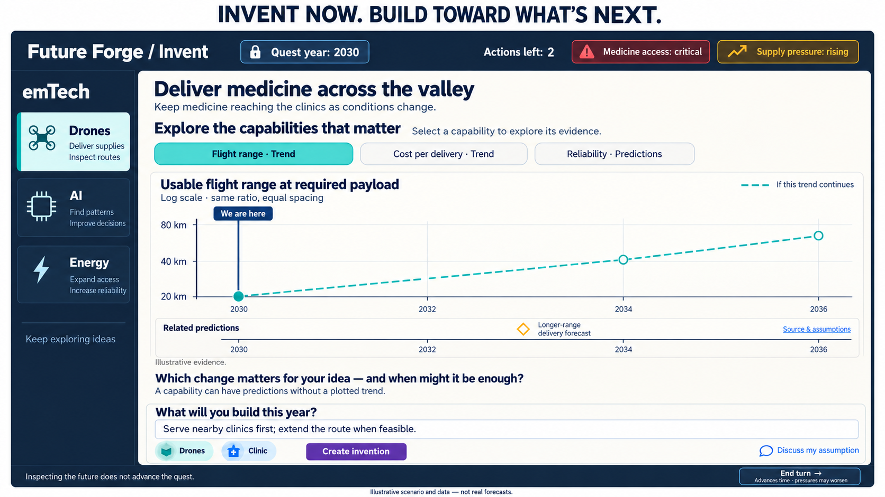

# Invent Capability Explorer — Design and Implementation Plan

> **Implementation handoff:** This document is for an AI coding tool working in this repository. Implement the tasks in order, with tests before behavior changes. For Hermes, use the subagent-driven-development skill if delegating implementation. Do not commit, push, publish, or modify content schemas/limits without a separate request.

**Goal:** Bring quantitative capability trends and related dated predictions into brainstorming, so learners can think about what becomes possible, what is good enough for their scenario, and what useful invention they can build in the current quest year.

**Architecture:** Add a read-only, focused evidence explorer to the existing shared Workshop Invent column. Use existing authored trends and the active run's prediction bank; keep one quantitative chart mounted at a time. Separate a pure evidence view-model, a small DOM/chart controller, and a thin `game.js` adapter; preserve simulation and AI-authority behavior.

**Tech stack:** Existing browser ES modules, HTML/CSS, Chart.js and its annotation plugin, and Node's built-in test runner. No framework, new chart library, model call, database migration, or content schema change is required.

**Status:** Approved design direction; implementation has not begun. This plan supersedes the earlier estimate-entry mockup and any suggestion of a freely selectable design year. It does not authorize unrelated redesigns in older planning documents.

---

## 1. Product intent and locked decisions

Future Forge teaches exponential thinking through invention. The learner should consider changes in capability, anticipate when they might become useful, and use that understanding to solve a problem. Looking at a chart is support for thinking—not a separate quiz or a complete feasibility model.

The learner must also keep the quest viable. An author can start a quest in a future year to bring a particular prediction into the playable horizon. The learner may need to ease crisis pressure with a limited invention now, spend their actions, end the turn, and improve or complete the solution later. Time is consequential; waiting indefinitely is not a solution.

### Must preserve

- The existing emTech selector, its idea clues, focus/busy behavior, and stack semantics.
- The quest title, place, briefing, spotlight/companion context, invention editor, Ask for ideas, minting, hex board, and feasibility/challenge flow.
- The existing right-hand Future vision / Log / AI inspect area and collapsible co-inventor. The image below omits that area to explain the new component; that is **not permission to remove it**.
- Existing current-year, crisis and action displays, with all values derived from live state.
- Existing Wait, End turn, multiplayer ownership and phase rules.
- Authored trend descriptions, units, milestones and citations; active package/side-loaded prediction provenance.

### Must not introduce

- A “My estimate” text field, number field, date picker, slider, draggable estimate marker, or other mechanism for recording a learner estimate.
- A required “good enough” threshold field, personal forecast score, reveal gate, quiz, or forecast submission.
- A freely changeable game year, preview-year mode, or future-year control that changes what an invention is evaluated against.
- A claim that the selected capability is the only capability that matters.
- A chart for every capability, fabricated quantitative data, invented uncertainty bands, AI-generated capability labels, or an assumed one-to-one relationship between a prediction and a plotted metric.
- A new roadmap form, replacement invention editor, tile grammar, or tutorial redesign.
- New gameplay costs for browsing, silent stack selection, automatic idea generation, or model calls when switching capability views.

### The accepted interaction

1. The learner focuses an emTech using the existing selector.
2. The explorer offers the authored capability trends available for that technology and a related-predictions view.
3. Selecting a capability changes the one displayed chart, its description, and its supporting evidence.
4. The learner considers which changes matter and when they might be enough. No answer is collected.
5. The learner invents for the **current quest year** using the existing editor and board.
6. Only real gameplay transitions advance the year; the explorer then reflects the new state.

## 2. Visual reference and the important revision



The reference is schematic. Its drone data, mission text, controls, labels and forecast are not production content. Do not copy those values into the application.

**Important revision after the mockup:** every actual trend has an authored description (`summary`, up to 900 characters). Reserve real space for that description. Do not reproduce the image's graph-dominated layout at the expense of the text, and do not shorten catalog content to make the component fit.

The actual app has a substantially narrower Invent column because it also contains the right-hand panel. Design to the **component's available width**, not the overall viewport width.

## 3. Scope and entrypoints

### This implementation

- Mount one explorer in the shared Workshop used by solo and the active hotseat/network invention.
- Add a non-modal, read-only evidence view; leave the existing invention composition and action surfaces functional.
- Reuse current trend catalog loading and active-run predictions.
- Preserve existing HUD year foresight and Look Ahead/Wait flows as compatible entrypoints. Do not delete or redirect their broader bulletins during this first implementation.
- The inline explorer removes the need to open those dialogs merely to see evidence while brainstorming. It does not need to eliminate every existing evidence surface to deliver the benefit.

### Out of scope

- Re-authoring trends/predictions or adding capability-to-prediction relationship fields.
- Removing existing catalog merge limits or changing validation ceilings.
- Sending the selected chart or its curve to the AI as new authoritative grounding.
- Changing package resolution, saved-run schema, simulation rules, billing, or published content.
- Refactoring historical/legacy multiplayer shells to add a second explorer. Their existing Wait dialog contracts must continue to work; current playable shared-workshop routes must receive the feature.

## 4. Detailed layout specification

### 4.1 Placement

Add a dedicated host immediately after the quest banner and before `.invent-form` in `index.html`, around the current `1183–1185` boundary:

- Proposed host ID: `invent-capability-explorer`.
- Proposed component class prefix: `capability-explorer`.
- Label the region “Capability outlook”.
- Keep it outside `#hex-tile-create-body` and outside nodes that the hex renderer replaces or hides during minting.
- Do not wrap, move or recreate the existing editor, selector, board, or right-hand panes.

The main Invent column remains its existing vertical scroll owner. Avoid a nested scrolling description, prediction list or chart viewport.

### 4.2 Component order

1. **Header:** “Capability outlook”; current focused emTech name; `Quest year: {state.year}`; collapse/expand control.
2. **Capability choices:** selectable buttons for available authored trends plus a distinct “Related predictions” choice when matching bank rows exist.
3. **Selected trend title and metadata:** authored name, capability, unit, compounding assumption and provenance.
4. **Description and chart:** responsive layout described below.
5. **Dated predictions rail:** aligned to the chart's actual year scale, with a compact accessible list/detail area.
6. **Sources and milestone details:** progressive disclosure, not a wall of duplicate text.
7. **One quiet reflection prompt:** “Which changes matter for your idea—and when might they be enough?” No answer control.

Use existing theme tokens and typography. The reference image's ivory panel is not a requirement to override the app theme. Keep evidence colors distinct from traffic-light feasibility and hex polarity colors.

### 4.3 Trend description is first-class content

The existing `summary` is the complete authored descriptive field. There is no separate `description` or `longDescription` field.

- Always show readable description text next to or above the chart; do not put the entire description behind a tooltip, information icon, or initially closed details element.
- For long descriptions, show a three-line excerpt in the default compact view and an explicit **“Read full description”** button only when actual overflow is measured.
- Expanding reveals the complete, unchanged authored text in normal document flow. “Show less” restores the compact view. Keep the control associated with the text using `aria-expanded` and `aria-controls`.
- Prefer CSS visual clamping rather than destroying/slicing the stored string. Provide the complete text to assistive technology without duplicate announcements.
- Detect overflow after layout and on width/font changes. Do not display a fake expansion control for text that already fits.
- Never summarize the description using AI, cut at an arbitrary character count, remove caveats, change the validator cap, or reduce font size to fit.
- Use a normal body-sized font and comfortable line height; maintain paragraph breaks where authored. Treat content as text, not trusted HTML.
- Preserve the expanded state for that trend while the same run/viewed invention remains active. Reset it on a new run; do not save it into gameplay snapshots.
- Long units, names, attribution and URLs must wrap without widening the Invent column.

### 4.4 Width-dependent behavior

Use a container query or an equivalent component-width measurement. Starting values below are implementation targets to verify in the browser, not excuses for overflow.

| Available component width | Layout |
| --- | --- |
| At least 760 CSS px | Description/metadata column around 30–35%; chart around 65–70%. Both have `min-width: 0`. Prediction rail belongs to the chart column and shares its plotting alignment. |
| 420–759 CSS px | Stack title/metadata, three-line description excerpt, then chart and prediction rail. Do not compress a prose sidebar into a narrow strip. |
| Below 420 CSS px | Same stacked layout, wrapped capability buttons, compact chart labels, and full-width prediction details. No page-level horizontal scrolling. |

- Initial chart height target: about 200–240 CSS px; do not scale it to the height of a fully expanded description.
- At narrow widths, show fewer axis labels rather than unreadably small labels or a horizontally scrollable chart.
- Expanded description/source/prediction details may increase overall height; the existing Invent column scrolls normally.
- Do not add a giant sticky evidence panel. The header, selector and description consume meaningful space, so the whole explorer must be collapsible to a short header containing selected trend and quest year.
- Default expanded on a new run. Remember explicit collapse during that run, including ordinary renders and year changes. Do not reopen it because a network patch arrived or a chart was selected elsewhere.
- On small screens, do not promise simultaneous full chart, full description, full editor and board visibility. Prefer readable content, one chart, and an explicit collapse control over shrinking everything.
- Preserve the existing HUD/action visibility and scrolling behavior. Do not add another editable year or another independent set of crisis meters.

### 4.5 Capability selector behavior

Use actual authored trends as the choices. The mock's “Flight range / Cost per delivery / Reliability” labels were examples, not a new taxonomy.

- One option per merged trend, keyed by `trend.id`; use the authored `name` as the concise visible label. Show `capability` and `unit` in the selected detail, not as a replacement fabricated title.
- A focused emTech is the primary evidence scope, including when no tile for it has been placed yet. Do **not** wait for it to enter `state.selectedTechIds`.
- If no emTech is focused, use the selected stack as a fallback scope. If neither exists, show “Choose an emTech to explore its capabilities.” Do not silently change tech focus or select a default stack entry.
- A learner can switch emTechs using the existing selector, then cycle among that technology's capabilities. A capability selection is local view state only.
- Preserve the selected trend while it remains available within that scope; remember it per scope during the same run. Otherwise select the first result from the existing merge ordering.
- Label the prediction-only option **“Related predictions”** (or “Predictions for {emTech}”). The bank does not provide a metric taxonomy that would justify inventing a “Reliability” capability tab.
- Use ordinary buttons with `aria-pressed`, not tabs unless the complete tab keyboard pattern is implemented. Wrap buttons and keep the selected state visually clear without relying on color alone.
- Reuse the existing maximum-eight merged trend behavior. This release is not an uncapped catalog browser; do not use the developer `includeAll` escape hatch. Do not label the set “all capabilities”.

## 5. Chart and timeline semantics

### 5.1 Quantitative trend

Reuse `js/capability-trend.js` mathematics and `js/trend-chart.js` chart construction.

- X is calendar year; Y is logarithmic and uses the authored unit.
- Show only the selected series, not an overlay of unrelated metrics and not a grid of charts.
- Use the current hydrated `state.year` for the fixed vertical year marker. Label it “Quest year” / “We are here”, not the real-world date.
- Omit `yearNext` in this surface. An “after Wait” line belongs to the explicit Wait flow, not the normal Invent explorer.
- Display the model curve as a dashed **trend model**, with “If this trend continues”. Do not present the model's historical portion as measured observations.
- Keep authored `reached` and `predicted` milestone statuses distinct (filled vs hollow plus text). A milestone need not lie on the model line.
- Do not flip a predicted marker to observed because the quest year passes it. Likewise, preserve the authored status of a reached marker even if this scenario starts earlier.
- Cost/latency trends may slope downward. Do not invert or relabel them as rising capability unless the content explicitly supplies that metric.
- Preserve halving, doubling and CAGR assumptions. Explain jargon in plain text, e.g. “Compound annual growth: {rate} per year”, rather than displaying an unexplained acronym alone.
- Show a text readout of the model value at the current quest year if that year is inside the authored domain. Label it as a model estimate, not an observed measurement or feasibility verdict.
- No user-created thresholds, personal estimate markers or movable year cursors. Hover/focus on existing evidence is inspection only.

### 5.2 Range and out-of-domain policy

The chart must not silently invent a continuation because a future-start quest lies outside a trend's supported domain.

- Sample the curve only within the authored `domain.start` and `domain.end`.
- For this explorer only, the displayed X range may expand to include the current quest year so its vertical marker remains visible. Do not extend curve data into that blank region.
- If the current year is outside the authored domain, show “This trend covers {start}–{end}; no projection is supplied for the current quest year.” Omit the current-year model value.
- Do not expand the chart to every prediction in the bank. Out-of-range predictions remain available in the list with their year and a clear “Outside this chart's range” label.
- Handle very narrow Y ranges: existing decade-only tick filtering can hide every label. Add an explorer-specific tick strategy if needed, with tests for positive non-decade ranges and descending trends. Do not fabricate zero on a log axis.

### 5.3 Predictions share time, not a fabricated Y value

The bank has `techIds` and `globalIds`, but no quantitative metric, trend ID or Y value. Therefore:

- For a selected trend, show rows whose `techIds` contain that trend's `techId`.
- Label this area **“Related {emTech} predictions and milestones”**, with a brief disclosure: “Related by technology; not measurements of this curve.”
- Show qualitative bank rows on a separate year-aligned rail beneath the chart. Never place them on the quantitative curve just because their dates match.
- Retain each row's authored kind: `prediction`, `milestone`, or qualitative `trend`. A bank row with `kind: "trend"` is not a chartable capability-trend object.
- Keep theme-only rows out of a metric's rail. They remain accessible through existing year foresight; do not present them as evidence of that metric.
- Do not use `foresightForYear()` as this rail's data selector: it is a limited, seeded bulletin selection and excludes future rows. Read full, resolved bank rows and filter deterministically.

**Alignment:** use the rendered Chart.js X scale (`chart.scales.x.getPixelForValue(year)`) and actual chart area, not percentages of the canvas's outer width. Y-axis labels occupy space. Update the rail after chart layout, resize, font loading, tech-drawer changes and component expansion. Position the rail overlay within the same measured CSS-width wrapper so high-DPI canvas pixels do not shift markers.

**Density:** group rail markers sharing a year and allow up to a few visual lanes before grouping. A group button opens that year's rows. Do not print every headline on the rail. Provide keyboard-accessible text buttons and a list so the canvas/rail is not the only access path.

**Default list:** initially show up to three nearest relevant rows, sorted by absolute distance from the quest year, then year, then ID. Keep the full relevant collection available through “Show all related evidence ({count})”, sorted chronologically with ID tie-breakers. Compute counts from the same collection; do not silently drop rows or duplicate them. Selection of a marker exposes that row even if it was outside the default three.

### 5.4 Prediction detail and sources

Show year, authored kind, headline, full detail, `claimBand`, source note and attribution when available. Resolve bank-level attribution through the existing normalizer; a row attribution overrides it. Preserve available attribution URL/date/quote.

Distinguish these two concepts in copy:

- **Calendar placement:** “At or before this quest's year” / “Ahead of this quest's year”.
- **Evidence status:** authored forecast/milestone and any explicit scenario premise.

Passing the date does not independently verify an assertion in reality. Conversely, do not change the engine's binding world-clock semantics in this UI task.

Show an assumed-premise badge only for prediction IDs explicitly granted by the resolved current premise, with the existing scope/limits. Do not infer a scenario grant from matching tech tags. If the premise cannot be resolved, do not invent one.

Trend citations come from `trend.sources`, not the merge-added `source` field. Show “Quest-authored” versus “Catalog reference” as provenance; show actual source links separately. Missing citations should read “No source link supplied”, not gain fabricated citations.

### 5.5 Prediction-only and failure states

| State | Required behavior |
| --- | --- |
| No focused tech and no stack | Invite emTech selection; no catalog wall and no automatic tech selection. |
| Matching predictions but no trend | Show the prediction-only list/timeline, no empty numeric plot. State “No plotted trend is supplied for this technology.” |
| Trend available but no matching prediction | Show chart/description and a calm “No related dated predictions in this quest's active bank.” |
| Neither available | State evidence coverage is unavailable; do not imply the technology is impossible. |
| Catalog loading | Show local quest-authored trends and bank rows immediately where available; loading status applies only to the missing catalog. |
| Catalog fetch fails with usable cached data | Keep the available reference and mark catalog status stale/unavailable as appropriate. |
| Catalog fetch fails with no catalog rows | Still show quest trends and predictions. Offer an explicit retry; no render-triggered retry loop. |
| Bound prediction bank missing/unresolved | State “This quest's prediction evidence is unavailable.” Do not substitute the ambient/default bank. Charts can remain visible with separate provenance. |
| Chart.js missing/canvas unavailable | Keep the full description, authored milestone values, citations and prediction list; show “Chart unavailable”. No crash and no loading spinner forever. |
| Active trend disappears after data refresh | Select the next valid option; do not keep stale title/description with a different chart. |

## 6. Evidence authority: preserve the actual contracts

This is a unified **presentation**, not a new unified data authority.

### 6.1 Trends

Current behavior merges the ambient `/api/trends` catalog with `state.mission.trends`, with quest records replacing matching catalog IDs after relevance filtering. Catalog content is not pinned to the immutable quest package. Preserve this behavior and label the source rather than pretending all visible curves came from the package.

Use `mergeTrendsForStack()` with the explorer's read-only evidence scope as `selectedTechIds`; this does not mutate the real stack. Preserve the existing spotlight and cap behavior. Do not change cross-tech ID override semantics in this feature.

### 6.2 Prediction bank resolution

Resolve exactly one bank for the current run:

1. Package-bound run/mission: use its matching prepared run bank; missing or mismatched state is unavailable, never ambient fallback.
2. Legacy assumed-premise quest: use its valid pinned bank; missing/invalid pinned state is unavailable.
3. Ordinary unbound legacy quest: use the current ambient bank loaded through the existing `/api/predictions` path.

Reuse `bankForRun`, existing validation, and premise helpers. Guard malformed package/assumed state before applying any ordinary-world fallback. Include mission-level binding in those guards, not only `runWorld.packageRef`.

Do not fetch `/api/predictions` expecting a package-specific bank. Do not concatenate banks, alter the active global bank, or cache solely by bank ID: different packages can legitimately use the same internal bank ID.

### 6.3 AI grounding boundary

The existing server rebuilds authoritative quest grounding and the prediction calendar through `applyAuthoritativeContext`. The hosted quantitative chart catalog is **not automatically fed to that evaluator**. The selected curve is not a newly authorized premise.

Do not claim “the AI evaluates against this exact curve”. This release exposes relevant evidence while preserving current evaluation rules. If exact curve-to-evaluator alignment is desired later, it requires a separate authority/prompt design—not a silent client-side payload addition.

## 7. Gameplay semantics and safety

Use the current hydrated invention's `state.year`, not the wall clock, `GAME.startYear`, a hard-coded 2026, or the table's shared year when viewing a different invention calendar.

Verified source behavior at planning time:

| Mode/action | Existing behavior to preserve |
| --- | --- |
| Solo End turn | Advances one year, applies one year of pressure rise, resets/refills turn resources. |
| Solo Wait | Advances configured `mission.yearsPerTurn` (normally two), applies pressure for the elapsed years, resets/refills turn resources, and may apply existing frontier risk. |
| Hotseat/network End turn | Passes the seat; table wrap advances calendars/shared pressure under multiplayer rules. Not every seat action advances the calendar. |
| Hotseat/network Wait | Advances the actor's invention by the configured step and ends the seat-turn. A wrapping handoff can also trigger ordinary table pressure; already-waited inventions avoid the extra personal year increment. |

Browsing/collapsing/reading/selecting evidence must change none of: year, AP, pressure, waits, budget, support, turn phase, stack, board, invention text or AI evaluation state. Do not call `dispatchSim`, `applyAction`, `sendAction`, `focusTech`, idea generation or timing assessment from capability buttons.

The existing `index.html` End turn tooltip says crisis meters are unchanged; it is stale relative to `js/sim/actions.js`. Correct that narrowly scoped misleading copy during implementation. Use mode-neutral copy where controls are shared; do not duplicate simulation arithmetic in the explorer. Preserve existing Wait confirmation and cancellation boundaries.

## 8. Repository map and integration points

Line references are planning-time navigation aids. Find functions by name before editing because the repository can move.

| File / symbol | Role and required treatment |
| --- | --- |
| `index.html:1183–1185` | New isolated host between quest banner and Invent form. |
| `index.html:1448` | Stale End turn tooltip; correct without changing action behavior. |
| `css/styles.css:7510`, `:8478`, `:12127` | Workshop columns, Invent scroll owner, existing creation panel. Scope new styles; do not globally resize panes. |
| `js/game.js::renderWorkshop` (~8607) | Shared workshop render; update explorer after state is coherent. |
| `js/game.js::focusTech` (~10091) | Update explorer only after existing focus/busy guards accept a change. Focused emTech may be unplaced. |
| `js/game.js::refreshHostedTrends` (~5505) | Refresh new view on success and failure; preserve existing Wait refresh. Use current state on completion. |
| `js/game.js::loadPredictionsFromServer` (~23581) | Notify the explorer after successful ambient bank activation; never replace a bound run's calendar. |
| `js/game.js::showScreen` (~4377) / quest reset | Destroy/suspend explorer when leaving workshop; reset run-local view state on a new run. |
| `js/game.js::mpHydrateAndRender`, `handleRoomPlayEvent` | Refresh after viewed invention/year/world changes without resetting draft/focus or causing patch storms. |
| `js/game.js::activePinnedBank`, `liveScenarioPremise` (~1540) | Existing run-bank/premise adapters; do not copy permissive ambient fallbacks into the new model. |
| `js/game.js::trendsForWaitConfirm`, `syncWaitTrendCharts`, `waitTrendCardHtml` (~10827–11048) | Reference for content fields and styling; do not reuse the whole multi-chart Wait renderer inside Invent. |
| `js/game.js::openYearForesightFromHud`, `showYearBulletinModal` (~21405) | Preserve broader year/news behavior; its truncated highlights are not the new evidence data source. |
| `js/capability-trend.js` | Validated schema, `valueAtYear`, curve sampling and merge rules. |
| `js/trend-chart.js` | Reuse chart building/mount/dispose with explicit explorer options that preserve Wait defaults. |
| `js/sim/world-foresight.js` | Prediction validation, attribution normalization and ambient bank accessor. Existing bulletin selectors have different selection semantics. |
| `js/sim/run-world.js`, `js/companion-context.js` | Run bank and premise resolution; package/legacy isolation. |
| `js/server/quest-world-context.mjs`, `js/server/fast-eval.mjs` | Authority reference only; no new evaluation behavior in this plan. |
| `js/sim/actions.js:299–443`, `js/sim/mp-session.js` | Preserve current End turn/Wait behavior. |
| `js/multiplayer/hotseat-bridge.js`, `js/multiplayer/room-bridge.js` | Viewed invention hydration; preserve read-only ownership behavior. |
| `js/main.js`, `index.html`, `package.json` | Cache versions and explicit syntax/test lists. |

## 9. Proposed new modules and contracts

The names in this section are **new proposed files/APIs**, not claims that they already exist.

### 9.1 `js/capability-explorer-model.js`

DOM-free module. Accept a read-only snapshot and previous view selection; return a plain view-model. Suggested exported functions:

- `resolveExplorerBank(snapshot)` → `{ status, bank, provenance }`.
- `buildCapabilityExplorerModel(snapshot, selection)` → normalized choice list, selected trend/prediction view, full description, relevant rows, source metadata, current-year/domain information and loading/error state.
- `selectRelatedEvidence(rows, techIds, year)` → full relevant rows plus default visible subset with deterministic ordering.

Snapshot fields should be explicit: `mission`, `runWorld`, `pinnedPredictionsBank`, `ambientBank`, `scenarioPremise`, `year`, `focusedTechId`, `selectedTechIds`, `catalogTrends`, and catalog/prediction load statuses. Use existing objects, not copies reconstructed from a title-page quest.

Do not let this module fetch, mutate state, read browser globals, call a model, or dispatch actions. Preserve full normalized prediction objects rather than mapping through `bulletinHighlight` and losing attribution detail.

Use choice keys with a type prefix, e.g. `trend:<id>` and `predictions:<scope-key>`. A missing previous selection must fall back deterministically; prefixing avoids a trend ID colliding with the prediction-only control.

### 9.2 `js/capability-explorer.js`

Small UI controller with a proposed interface:

```js
const explorer = createCapabilityExplorer(host, dependencies);
explorer.update(snapshot);
explorer.destroy();
```

`dependencies` supplies chart creation/destruction and optional explicit retry callback. It must not expose a gameplay action dispatcher.

Controller responsibilities:

- Own selection, expanded descriptions, selected prediction detail, collapse state, observers and listeners.
- Mount zero or one chart. Destroy before replacing a canvas; clear on collapse/unmount, and recreate at a measurable size on expansion.
- Use delegated events or equivalent idempotent binding. Never recreate the host or neighboring editor.
- Render plain text safely; restrict outbound source URLs to expected safe HTTP(S) schemes and use `rel="noopener noreferrer"` for new tabs.
- Use an update fingerprint based on actual view-relevant data, not only IDs. Same-ID refreshed content must update; unrelated room traffic must not remount the chart.
- Use a view identity including run instance, quest/package revision and viewed invention/seat identity. Reset on new runs even if quest IDs repeat. Never key world isolation by bank ID alone.
- Preserve keyboard focus and Invent scroll position on ordinary updates. A capability button click may update its panel, but must not erase a focused invention draft.
- Cancel/disconnect observers and listeners on destruction. Ignore obsolete component callbacks after navigation; asynchronous catalog results must render from the current state, not a captured old mission.

### 9.3 `js/game.js` adapter

Add a small `syncCapabilityExplorer()` integration function and controller reference. Keep new DOM/rendering logic out of the already-large game module.

- Build the snapshot from current state and focus; call the controller after accepted focus changes and coherent workshop hydration.
- Connect catalog/bank load completion, including failures, to the same synchronization function.
- A render must not initiate a fetch. Reuse existing startup load; retry is an explicit user action.
- Handle hidden/briefing/maximized-board states without fighting existing layout rules. A hidden canvas must not be measured as if visible.
- Guard legacy shell paths where the host does not exist.
- Do not add evidence selection to saved-run/cloud payloads or server authority. It is local UI state.

### 9.4 Chart options

Extend `buildTrendChartConfig` with backward-compatible optional controls for the explorer: current-year label, dashed-model presentation, display bounds, appropriate ticks, and a layout/resize notification needed by the external rail. Exact option names can be chosen during implementation; keep all existing Wait call sites working without new arguments.

Do not reorder datasets or change tooltip assumptions unnecessarily: current tests depend on curve/reached/predicted dataset indices. Add explicit tests if a structural change is unavoidable.

## 10. Implementation tasks

For each task: add a focused failing test, run it to confirm the intended failure, implement the smallest behavior, rerun, then inspect the diff. Do not commit automatically.

### Task 1 — Baseline and fixtures

**Files:** existing relevant tests; new `js/capability-explorer-model.test.js`.

1. Re-run `git status --short` and inspect existing modifications; do not overwrite unrelated side-load work or content.
2. Read the modules listed above. Confirm current symbol names and existing test conventions.
3. Create test fixtures in the test module from validated existing trend/prediction shapes: multiple curves for one tech, another tech, a long summary, attributed predictions before/after the quest year, and two package worlds sharing a bank ID but different rows.
4. Run existing focused baselines listed in §11 before modifying runtime code.

**Acceptance:** tests distinguish focused-but-unplaced emTech from placed stack, and package identity from bank identity. Use existing validators; no production fake content.

### Task 2 — Bank resolution and relevance model

**Create:** `js/capability-explorer-model.js`; extend its test file.

1. Test ordinary ambient, package-bound, legacy-pinned and unavailable-bound cases, including mission-level binding with incomplete run state.
2. Implement resolution using existing helpers and explicit fail-closed guards.
3. Test all relevant future/past rows, strict tech relevance, full attribution retention and no unrelated theme-only rows in a metric lane.
4. Implement deterministic selection without calling seeded bulletin selectors.
5. Freeze input fixtures or compare before/after snapshots to prove no mutation.

**Acceptance:** no ambient rows leak into a bound/assumed quest, even if the bank is missing; prediction-only views work; a qualitative bank trend is never used as chart data.

### Task 3 — Capability choices and selection persistence

**Files:** new model and tests.

1. Test focused emTech with empty stack, fallback stack without focus, and neither present.
2. Reuse normal merge precedence/spotlight ordering/cap with the derived evidence scope.
3. Test selection preservation, removed trend fallback, same-ID content refresh, and run/seat change reset.
4. Include a prediction-only choice without inventing a new capability name.

**Acceptance:** choosing a capability changes only local view state and every displayed title/description/unit/curve belongs to the same selected record.

### Task 4 — Explorer chart behavior

**Modify:** `js/trend-chart.js`, `js/trend-chart.test.js`.

1. Test dashed model and fixed quest-year marker without an after-Wait marker.
2. Test descending cost series, narrow positive ranges, authored reached/predicted statuses, and milestones off the model curve.
3. Test display-range extension without sampling beyond the authored domain, plus current-year value omission outside it.
4. Implement the optional behavior while preserving existing Wait defaults and tests.
5. Expose/update scale information for rail alignment after actual layout.

**Acceptance:** model line remains conditional, domain handling is explicit, and no chart code treats the current game year as an observation cutoff.

### Task 5 — DOM component and full descriptions

**Create:** `js/capability-explorer.js`, `js/capability-explorer.test.js`.

1. Test markup/content selection with a full-length summary and attribution; hostile strings must render as text.
2. Implement component header, selector, selected detail, measured description expansion, sources and milestones disclosure.
3. Test one-chart lifecycle through switch/collapse/expand/destroy, using injected fake chart dependencies and the repository's lightweight DOM-test style.
4. Test keyboard controls, stable focus, preservation of local view state, and absence of estimate/year/threshold input controls.
5. Provide chart-library failure and no-evidence views without blocking invention.

**Acceptance:** complete authored summary remains available unchanged; no unsupported input controls; chart count never exceeds one per explorer.

### Task 6 — Prediction rail and detail

**Files:** new controller/tests; chart tests as necessary.

1. Test row positions against the actual X scale, not outer canvas width.
2. Test multiple rows in one year, out-of-range rows, zero rows and dense groups.
3. Implement keyboard-accessible markers/groups plus default/all-row list and full detail.
4. Test count accuracy, source fallback, kind/status distinctions and exact premise-reference labeling.
5. Verify chart and rail alignment after resize and expanded description.

**Acceptance:** no qualitative Y coordinates, no hidden-only evidence, and selecting a row never changes the calendar.

### Task 7 — Workshop host and responsive CSS

**Modify:** `index.html`, `css/styles.css`.

1. Add the isolated host and component-scoped styles.
2. Implement wide description/chart split and narrow stacked layout using component width.
3. Add wrapping selector, readable summary, stable chart height, collapse control and visible focus styles.
4. Preserve the existing right pane, co-inventor collapse, tech drawer, brief and board-maximize behavior.
5. Correct the stale End turn tooltip without changing action wiring.

**Acceptance:** no editor/board replacement, no page horizontal overflow, and 900-character descriptions work expanded and collapsed in the actual multi-column app.

### Task 8 — State and lifecycle integration

**Modify:** `js/game.js`; **create:** `js/capability-explorer-integration.test.js`.

1. Add a thin snapshot/controller adapter at `renderWorkshop` and accepted `focusTech` updates.
2. Refresh after catalog and ambient-bank load success/failure; keep package binding intact.
3. Refresh after solo year changes and hotseat/network viewed-invention hydration.
4. Dispose on leaving/reset; guard hidden/missing hosts and obsolete async callbacks.
5. Add integration tests around actual source-extracted hooks where practical, matching existing tests in `js/side-split.test.js` and cloud Continue tests.
6. Assert no simulation/network action or AI call is caused by evidence browsing. Verify no draft overwrite from routine room updates.

**Acceptance:** future-start quests and seat switches show the correct current invention year, bank and tech scope; no stale-world flash or patch-induced chart churn.

### Task 9 — Regression tests, script registration and cache versions

**Modify:** `package.json`, `js/main.js`, `index.html`; update direct import version strings only as needed.

1. Explicitly add new test files to `npm run test`; the script does not automatically discover all top-level test modules.
2. Add new runtime modules to `check:syntax`.
3. Bump the `game.js` import version in `js/main.js`, the main script version in `index.html`, and the stylesheet version in `index.html` for changed assets. Inspect existing tokens first; do not assume old version numbers from this plan.
4. If a shared changed module needs a cache-busted direct import, keep its specifier consistent across importing paths. Do not create duplicate stateful auth/foresight module instances.
5. Run focused and full verification, then browser acceptance below.

**Acceptance:** old Wait/HUD routes, Continue/package restoration and multiplayer rules still pass; direct served asset URLs return the revised code.

### Task 10 — Documentation and handoff

**Modify:** `docs/future-forge.md`, `docs/capability-trend-schema.md`, `docs/capability-trends-remote.md`, `docs/predictions-bank.md` only where the shipped UI description changes.

1. Document the inline explorer, description expansion and retained Wait/year entrypoints.
2. Document that a capability view is not a new authoritative grant or simulation action.
3. Keep schema references and limits unchanged; do not claim new authoring fields exist.
4. Record test commands/results, browser viewport checks, remaining blockers and screenshots in the implementation handoff.

**Acceptance:** report what actually ran. Do not claim browser or authenticated network validation from source inspection alone.

## 11. Verification commands and acceptance matrix

### Existing focused baseline

Run from repository root:

```bash
node --test js/capability-trend.test.js js/trend-chart.test.js js/trends-remote.test.js js/sim/world-foresight.test.js js/sim/run-world.test.js js/sim/pressure.test.js js/sim/mp-session.test.js js/multiplayer/hotseat-bridge.test.js js/multiplayer/room-bridge.test.js js/side-split.test.js
```

### New focused tests, after files exist

```bash
node --test js/capability-explorer-model.test.js js/capability-explorer.test.js js/capability-explorer-integration.test.js js/capability-trend.test.js js/trend-chart.test.js
```

### Required full checks

```bash
npm run test
npm run check:syntax
npm run check:portal-spa
git diff --check
```

Expected results are exit code zero and no failing tests. Do not invent test counts. Check the actual output.

### Browser acceptance

Use the repository's normal local start path (`npm start`) or an already-running authorized development instance. Do not print/read credential files, change hosted content, or publish. For offline data, the existing `FF_TRENDS_REMOTE_URL` local fixture configuration can supply `test/fixtures/trends/catalog.json`; use valid existing quest/package fixtures rather than bypassing account/package gates.

Use browser tools available to the implementing agent. The repository does not currently declare Playwright or Puppeteer; do not assume a browser-test library is installed or add a dependency without justification. If the required live mode is inaccessible, report that specific browser gate as blocked rather than calling source tests equivalent.

Test actual layout at desktop 1440×900 and laptop 1280×720, tablet/narrow pane around 768×1024, and mobile 390×844; also test 200% zoom and a narrow Invent column with the right panel visible. Record actual component widths and bounding boxes, not just viewport screenshots.

| Scenario | Must verify |
| --- | --- |
| Typical/short description | Text visible without an unnecessary expand control; chart and editor readable. |
| Description at the existing 900-character ceiling | Readable excerpt, working full expansion, all content intact, no overlap or nested scroll trap. |
| Long title/unit/source and dense capability choices | Wrapping, focus visibility and no page-level horizontal overflow. |
| Focus an unplaced emTech | Evidence appears without AP spending, minting or adding it to the stack. |
| Cycle several capabilities repeatedly | One chart, correct description/unit/sources each time; draft and scroll remain intact. |
| Predictions only / charts only / neither | Correct explicit empty/coverage states; invention remains usable. |
| Select a prediction / open a source | Correct full attribution and date; no calendar movement. |
| Future-start quest and out-of-domain year | Actual quest year is shown; blank unsupported projection region is explained. |
| End turn / Wait cancel / Wait confirm | Existing mode-correct year/AP/crisis behavior; explorer follows results, never causes them. |
| Hotseat seat switch / network viewed invention / reconnect | Correct viewed calendar and bank; no leakage from another seat or previous run. |
| Package A and B with the same bank ID | Different package rows stay isolated; no ambient merge. |
| Missing bound bank / delayed catalog / offline catalog | Explicit errors, local evidence retained, no default-calendar substitution or retry loop. |
| Co-inventor expanded/collapsed, all right-panel tabs, tech drawer and board maximize | Existing controls remain usable; chart resizes or suspends cleanly. |
| Keyboard-only and assistive text | Selector, disclosure, prediction list and collapse usable; no reliance on canvas hover or color alone. |

## 12. Definition of done

- [ ] Trends and relevant predictions are visible together during Invent without opening Wait or clicking the calendar.
- [ ] Selecting a capability shows one chart and the matching authored description, metric, units, assumptions and sources.
- [ ] Full descriptions have a verified responsive layout, including the existing maximum-length case.
- [ ] Related predictions share the year scale without being represented as quantitative observations.
- [ ] Prediction-only evidence is supported without invented metric categories or curves.
- [ ] No estimate input, threshold form, personal marker, quiz or freely settable game year exists.
- [ ] Focused-but-unplaced technologies work; browsing never changes gameplay or invokes the AI.
- [ ] Actual quest/viewed-invention year, including future starts, is used everywhere.
- [ ] Package/legacy calendars remain isolated; missing bound worlds do not fall back to ambient evidence.
- [ ] Existing emTech ideas, editor, board, action rules, HUD/year flow and right-hand panes are preserved.
- [ ] Chart lifecycle, async refreshes, seat switches and long-content layouts have been exercised, not merely inspected.
- [ ] New tests are registered; required checks and browser gates are reported honestly.
- [ ] Only intended implementation files are changed; no automatic commit, push or deployment.

## Planning verification note

This document was prepared from current source inspection on branch `main`. Existing unrelated side-load script/test edits and untracked content were present and must be left alone. The reference PNG was copied under `docs/assets/` so the handoff does not depend on a temporary image-generation cache path.

Planning checks performed:

- The exact existing focused-baseline command in §11 was executed: **189 tests passed, zero failed**.
- Existing file references and the local mockup link were checked; proposed new modules are explicitly identified as new.
- `git diff --check` passed for the tracked working-tree changes. New documentation was separately checked for whitespace and link integrity.
- No application implementation, full-suite release verification, or live-browser acceptance was performed as part of this documentation task.
